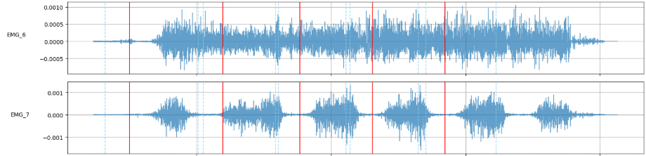
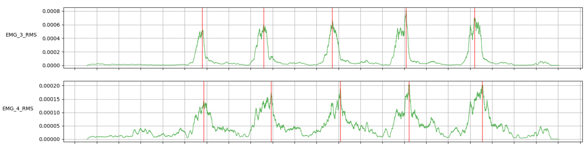
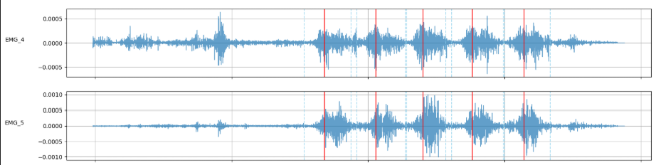

# preprocessing_1st: 1차 데이터 전처리

1차 데이터(2025.06 수집, sub1–14, 운동 10종, 균형/불균형)를 NAS의 센서 CSV부터 모델 입력 파일까지 만드는 전처리 파이프라인입니다.

**순서대로 실행되는 스크립트 7개**(step1–7)로 구성됩니다.

```
NAS CSV ─step2(점검)→ step3 병합 → step4 라벨 → step5 정렬 → step6 다운샘플 → step7 counting 라벨
(.hpf ─step1→ CSV 는 NAS CSV를 만든 변환 과정. 참고용이며 실행할 필요 없음)
```

### 프로젝트 목적

**팔(상완)에 붙인 EMG/IMU만으로** 아래 세 가지가 가능한지 검증하는 프로젝트입니다 (삼성 산학).

| 과제 | 내용 | 이 파이프라인의 산출물 |
|---|---|---|
| 운동 종목 classification | 10종 운동 자동 인식 | `emg_imu_downsampled_sensor3_4.csv` (STEP6) |
| 운동 횟수 counting | rep 자동 카운트, 운동 구간 인식 | `emg_imu_upsampled_sensor3_4.csv` (STEP7) |
| balance(불균형) detection | 좌우 근력·자세 불균형 인식 | `emg_imu_downsampled_sensor3_4_unbal.csv` (STEP6) |

### 센서 배치 (Delsys Trigno, sensor 2–8, 센서마다 EMG 1ch + Acc 3축)

| 센서 | 균형 데이터 (한쪽 측정) | 불균형 데이터 (좌우 측정) |
|---|---|---|
| 2 | 왼 전완 | 왼 전완 |
| **3** | **왼 이두** | **왼 이두** |
| **4** | **왼 삼두** | **왼 삼두** |
| 5 | 왼 삼각 | 오른 전완 (벤치프레스: 오른 대흉, 랫풀다운·바벨로우: 오른 광배) |
| 6 | 왼 승모 (벤치프레스: 오른 대흉) | **오른 이두** |
| 7 | 왼 광배 | **오른 삼두** |
| 8 | 왼 대흉 | 왼 대흉 (랫풀다운·바벨로우: 왼 광배) |

- **상완(이두근 장두·삼두근 외측두):** 균형 데이터는 3, 4 (왼팔), 불균형 데이터는 3, 4 (왼팔) + 6, 7 (오른팔). 프로젝트의 핵심 입력입니다.
- 나머지 센서는 운동 종목에 따라 전완근, 등, 가슴, 어깨 등에 붙인 보조 채널입니다.
- 이 파이프라인에서 센서를 쓰는 곳
  - STEP5 정렬: 2–8 전체 중 peak가 가장 잘 맞는 센서를 고름 (정렬용일 뿐 모델 입력 아님)
  - STEP6 다운샘플: 3, 4, 6, 7 (`DOWNSAMPLE_SENSORS`). 불균형 데이터에서는 좌우 이두·삼두입니다. **균형 데이터에서는 6, 7이 왼 승모·광배(벤치프레스는 6 = 오른 대흉)라 상완이 아닙니다.** 균형 데이터로 상완만 쓰려면 모델에서 3, 4만 고르세요.
  - STEP7 counting: 3, 4 (`COUNTING_SENSORS`) = 왼 이두·삼두. 균형·불균형 모두 상완입니다.
- 수집 설계
  - 균형 데이터 (운동 인식 과제): 상체 한쪽 측정. 고정 2ch(이두근 장두, 삼두근 외측두) + 변동 5ch(전완근 1, 등 2, 가슴 1, 어깨 1)
  - 불균형 데이터 (불균형 인식 과제): 좌우 대칭 측정. 양쪽 이두근 장두, 삼두근 외측두, 전완근

---

## 목차
1. [폴더 구조](#1-폴더-구조)
2. [원본 데이터 준비](#2-원본-데이터-준비)
3. [실행](#3-실행)
4. [단계별 설명](#4-단계별-설명)
5. [최종 산출물](#5-최종-산출물)
6. [배경: 왜 정렬이 필요한가](#6-배경-왜-정렬이-필요한가)

---

## 1. 폴더 구조

```
preprocessing_1st/
├── README.md
├── run_all.sh                 # 전체 실행
├── requirements.txt
├── docs/alignment/            # README 6절 그림
├── src/
│   ├── config.py              # 경로·샘플링·운동별 파라미터·제외 파일 목록
│   ├── common.py              # 메타 로딩, 파일명 정규화, pEMG 전처리 공통 함수
│   ├── step1_hpf_to_csv.py    # (참고) .hpf → CSV 변환 + Recording Date 요약표. NAS CSV를 만든 코드
│   ├── step2_check_inputs.py  # 입력 점검 (누락·매칭 실패 리포트)
│   ├── step3_merge_sensor.py  # 센서 병합 + 임시 절대시간 + pEMG RMS
│   ├── step4_label_abs_time.py# 영상 라벨 → 임시 절대시간
│   ├── step5_align_labels.py  # ★ 라벨 ↔ EMG 정렬 (offset)
│   ├── step6_downsample.py    # 148Hz 다운샘플 (모델 입력)
│   └── step7_counting_label.py# counting용 샘플 단위 0/1 라벨
└── data/
    ├── raw/                   # ① 센서 CSV (NAS 1st/data)        ← 직접 넣기
    ├── labels/                # ② 영상 라벨 CSV (NAS timestamp_label) ← 직접 넣기
    ├── meta/                  # ③ video_csv_info.xlsx              (들어 있음)
    ├── hpf/                   # (참고) Trigno 원본 .hpf. step1을 돌릴 때만 사용
    ├── interim/               # 중간 산출물 (자동 생성)
    └── output/                # 최종 산출물 (자동 생성)
```

---

## 2. 원본 데이터 준비

파이프라인 입력은 아래 **3가지**이며, 모두 NAS에 있습니다. 정해진 위치에 두면 나머지(병합, 정렬, 다운샘플, counting 라벨)는 스크립트가 순서대로 만듭니다.

| | 원본 | → 둘 위치 | 비고 |
|---|---|---|---|
| ① | 센서 CSV: NAS `1st/data/<운동>/<balance\|unbalance>/*.csv` (895개) | `data/raw/` | 운동 폴더째 복사 |
| ② | 영상 라벨: NAS `1st/label/timestamp_label/*.csv` (953개) | `data/labels/` | 그대로 복사. `absolute_label/`은 복사하지 않음 |
| ③ | `video_csv_info.xlsx` (1040행, bal + unbal 전체) | `data/meta/` | **이미 들어 있음.** 엑셀을 수정했다면 이 파일을 교체 |

준비가 끝나면 3절 순서대로 실행합니다. 가장 먼저 step2가 세 입력이 서로 잘 맞는지 점검합니다.

### ① 센서 CSV → `data/raw/<운동>/<balance|unbalance>/`

NAS `1st/data/` 아래 운동 폴더들을 그대로 복사합니다.

```
data/raw/
├── deadlift/
│   ├── balance/     sub1_deadlift_50_Plot_and_Store_Rep_1.0.csv, ...
│   └── unbalance/   sub6_deadlift_Plot_and_Store_Rep_1.15.csv, ...
├── barbellrow/      (balance만)
├── latpulldown/
├── benchpress/
├── barbellcurl/
├── bte/
├── ohp/
├── dips/            (balance만)
├── pushup/          (balance만)
└── pullup/          (balance만)
```

**불균형 데이터가 있는 운동:** deadlift, latpulldown, benchpress, barbellcurl, bte, ohp **6종뿐입니다.** dips, pushup, pullup, barbellrow는 동작 특성상 좌우 비대칭(불균형) 자세를 만들 수 없어 **처음부터 불균형 데이터를 수집하지 않았습니다.** 이 4종에 `unbalance/` 폴더가 없는 것은 누락이 아닙니다.

| 규칙 | 설명 |
|---|---|
| 운동 폴더명 | `deadlift, barbellrow, latpulldown, benchpress, barbellcurl, bte, ohp, dips, pushup, pullup` (철자 그대로). 출력의 `exercise` 값도 같음 |
| 등록 여부 | 엑셀 `csv_filename`에 있고 `normal_data`가 `x`가 아닌 파일만 처리 (엑셀에 없으면 step2가 `sensor_not_in_meta`로 알려줌) |
| 파일명 | **바꾸지 말 것.** 대소문자, 앞뒤 공백, 한글 NFC/NFD 차이, NAS 복사 중 깨진 한글(`추가` → `추가`)은 자동으로 맞춤. `deadlfit`, `deadllift` 같은 오타는 엑셀에도 같은 철자라 그대로 매칭됨 |
| subject | 엑셀 `subject_id`로 정함 |
| 하위 폴더 | `balance/` 아래에 하위 폴더가 더 있어도 재귀적으로 찾음 |

**CSV 형식** (Trigno 채널마다 `<채널명>_time`, `<채널명>` 두 열)

| 컬럼 | 의미 |
|---|---|
| `Trigno sensor {i}: EMG {i}` (i = 2–8) | EMG 원신호 (Volts), 1926 Hz |
| `Trigno sensor {i}: Acc {i}.{X,Y,Z}` | 가속도 (g), 148 Hz. EMG보다 짧아 뒤쪽은 NaN |
| `Trigno sensor 3: EMG 3_time`, `Trigno sensor 3: Acc 3.X_time` | 0초부터의 상대시간(s). **모든 센서가 sensor 3의 시간축을 공용으로 사용** |

### ② 영상 라벨 CSV → `data/labels/<video_name>.csv`

영상을 보며 수동으로 찍은 rep별 Start / Peak / End 파일입니다 (NAS `1st/label/timestamp_label/`).

```
data/labels/
├── 20250610_133531.csv
├── 20250610_133936.csv
└── ...
```

| 규칙 | 설명 |
|---|---|
| 파일명 | 영상 파일명에서 `.mp4`만 뺀 것. 엑셀 `video_name`과 매칭됨 |
| 컬럼 | `Index, Start, Peak, End` (rep 1개 = 1행. `Index`는 다시 매기므로 없어도 됨) |
| 값 형식 | 영상 기준 상대시간 문자열 `mm:ss.sss` (예: `00:05.320`) |

`absolute_label/`(영상 쪽 AbsoluteTime 앵커)은 **필요 없습니다**. 신뢰도 문제로 최종 방식에서 쓰지 않습니다.

### ③ 메타데이터 → `data/meta/video_csv_info.xlsx`

같은 `csv_filename`이 두 번 나오는 행이 1개 있는데, 첫 행만 사용합니다.

| 사용하는 컬럼 | 의미 |
|---|---|
| `csv_filename` | 센서 CSV 파일명 (매칭 키) |
| `video_name` | 영상 파일명 (라벨 CSV 매칭 키) |
| `start_time` | 센서 녹화 시작 절대시간 = hpf `RecordingDate` (아래 참고). 임시 절대시간의 기준 |
| `subject_id, exercise, weight_kg, rep` | 메타. `rep == 1` → `is_1RM` |
| `unbal_normalside` | 불균형 방향 (`o` 정상 / `l` / `r`) |

### 참고: NAS CSV의 출처 (hpf → CSV)

NAS의 CSV는 Trigno 원본 `.hpf`를 변환한 것이고, 엑셀 `start_time`도 hpf에서 나왔습니다. **전처리를 돌리는 데는 필요 없으며**, 원본을 다시 변환하거나 새 데이터를 추가할 때만 참고합니다. 변환 코드는 `step1_hpf_to_csv.py`입니다 (4절 STEP 1).

**hpf 원본 구조** (수집 당시 저장 구조. step1은 이 구조를 입력으로 받음)

```
<날짜>/                          250610, 250611, 250612, 250616, 250620, 250624, 250625, 250626, 250627
├── balanced/<운동>/*.hpf         → CSV: <운동>/balance/
└── unbalanced/<운동>/*.hpf       → CSV: <운동>/unbalance/
```

- 수집 당시 운동 폴더명에 `deadlfit`, `barbelrow` 오타가 있습니다 (step1은 `deadlift`, `barbellrow`로 바로잡아 저장).
- 변환 결과 CSV를 운동 기준(`<운동>/<balance|unbalance>/`)으로 다시 묶은 것이 NAS `1st/data/`입니다.
- NAS `1st/hpf_data/`의 hpf도 운동 기준으로 다시 묶여 있어 날짜 폴더가 없습니다. step1에 넣으려면 위 날짜 구조로 다시 배치해야 합니다 (날짜는 hpf `RecordingDate`로 알 수 있음).

**`start_time` / `end_time`의 출처**
- hpf 파일 앞부분 XML 헤더의 `<RecordingDate>`(예: `2025/06/04 14:34:24.0606115`)가 센서 녹화 시작 시각입니다.
- 이 값을 `start_time`, `start_time + 녹화 길이`를 `end_time`으로 정리한 표가 `all_hpf_summary.csv`이고, 엑셀 두 열은 이 표에서 옮겨 적은 값입니다. NAS `1st/hpf_data/`의 hpf 중 엑셀에 있는 732개는 `RecordingDate`와 엑셀 `start_time`이 모두 일치합니다.
- 주의: 헤더의 `<ChannelInformation><StartTime>`은 AM/PM이 없는 12시간제입니다(14:34 → `02:34`). 절대 쓰지 마세요.

---

## 3. 실행

```bash
cd preprocessing_1st
pip install -r requirements.txt

bash run_all.sh                    # step2→7 전체

# 또는 단계별 (위에서부터 순서대로)
python src/step2_check_inputs.py   # 입력 점검 (파일 수정 없음) → data/interim/input_check.csv 확인
python src/step3_merge_sensor.py   # 센서 병합 + RMS (--group balance|unbalance 로 하나만 가능)
python src/step4_label_abs_time.py # 라벨 → 임시 절대시간
python src/step5_align_labels.py --plot   # ★ 정렬 + 검수 그림
python src/step6_downsample.py     # 148Hz 모델 입력
python src/step7_counting_label.py # counting용 0/1 라벨
```

- **step2 결과는 꼭 확인하세요.** `input_check.csv`에 `meta_without_sensor`, `label_not_in_meta` 등이 있으면 해당 파일은 이후 단계에서 빠집니다 (4절 STEP 2 표 참고).
- 각 단계는 이전 단계 산출물만 있으면 따로 다시 돌릴 수 있습니다. 예를 들어 정렬 파라미터만 바꿨다면 step5만 다시 돌리면 됩니다.
- step3, step6은 결과를 파일 단위로 이어 쓰므로 메모리를 많이 쓰지 않습니다. 대신 **step3 출력 CSV는 수 GB 단위**가 될 수 있습니다.
- OS 제한은 없습니다 (Mac/Windows). step1만 Windows 전용입니다.

---

## 4. 단계별 설명

```
(참고) hpf/ ── STEP1 ─→ raw/<운동>/<balance|unbalance>/*.csv,  meta/all_hpf_summary.csv

raw/ · labels/ · meta/ ── STEP2 (점검) ─→ interim/input_check.csv

raw/ (센서 CSV) ─┬─ STEP3 ─→ interim/emg_imu_rms_abs.csv, unbalanced_merge.csv
                 │           interim/rms_cache/*.npz ──────────┐
                 │                                             ▼
labels/ ── STEP4 ─→ interim/absolute_labels.csv ──────→ STEP5 ─→ output/adjusted_labels_filtered.csv ★
                                                               └→ output/alignment_summary.csv
interim/emg_imu_rms_abs.csv ┐                                          │
interim/unbalanced_merge.csv┴── STEP7 ←── adjusted_labels_filtered.csv ┘
                                  └─→ output/emg_imu_upsampled_sensor3_4[_unbal].csv
raw/ ───── STEP6 ─→ output/emg_imu_downsampled_sensor3_4[_unbal].csv
```

### STEP 1. (참고) hpf → CSV: `step1_hpf_to_csv.py`
NAS CSV를 만든 변환 과정입니다. **일반적인 전처리에서는 실행하지 않습니다.** hpf 원본에서 CSV를 다시 만들거나 새 데이터를 추가할 때만 씁니다.

1. `data/hpf/<날짜>/<balanced|unbalanced>/<운동>/*.hpf`를 찾습니다.
2. **CSV 변환:** `HPF.dll`의 `HPFReader`로 채널별 데이터를 읽어, 채널마다 `<채널명>_time`(= 샘플번호 / 샘플레이트), `<채널명>` 두 열을 만듭니다. 짧은 채널(Acc)의 뒤쪽은 NaN입니다.
3. 저장 위치: `data/raw/<운동>/<balance|unbalance>/<같은 파일명>.csv`. 이미 CSV가 있으면 건너뜁니다 (`--overwrite`로 재변환).
4. **요약표:** hpf 헤더 `RecordingDate` → `data/meta/all_hpf_summary.csv` (`file_name, start_time, end_time, duration_sec, date, type, exercise`). 엑셀이 있으면 `start_time` / `end_time` 일치 개수를 `[CHECK]`로 출력합니다.

```bash
python src/step1_hpf_to_csv.py                  # 변환 + 요약표 (Windows)
python src/step1_hpf_to_csv.py --summary-only   # 요약표만 (OS 무관)
```

| 실행 조건 | 내용 |
|---|---|
| OS | CSV 변환은 **Windows 전용** (`--summary-only`는 OS 무관) |
| 소프트웨어 | EMGworks 설치 → `C:\Program Files (x86)\Delsys, Inc\EMGworks\Matlab Conversion Library\HPF.dll` (경로가 다르면 `config.py`의 `HPF_DLL_PATH` 수정) |
| Python 패키지 | `pythonnet` (requirements.txt에 Windows 한정으로 포함) |
| 자주 나는 오류 | `module 'clr' has no attribute 'AddReference'` → 이름이 같은 다른 `clr` 패키지가 깔린 것. `pip uninstall clr` 후 `pip install pythonnet` |

### STEP 2. 입력 점검: `step2_check_inputs.py`
엑셀, 센서 CSV, 라벨을 파이프라인과 **같은 매칭 규칙**으로 대조해, 처리 중에 조용히 빠질 파일을 미리 보여줍니다. 아무 파일도 고치지 않습니다.
출력: `interim/input_check.csv` (`issue, name, group, subject, exercise, detail`)

| issue | 의미 | 조치 |
|---|---|---|
| `meta_without_sensor(normal_data=x)` | 엑셀에는 있지만 센서 파일 없음. 실패·삭제 데이터 | 원래 빠지는 게 맞음 |
| `meta_without_sensor` | 엑셀에는 있고 `normal_data=o`인데 센서 파일 없음 | **원본 위치 확인** |
| `sensor_not_in_meta` | 센서 파일이 엑셀에 없음 | 엑셀 `csv_filename` 철자 확인 |
| `sensor_name_repaired` | 깨진 한글 파일명을 복원해 매칭함 | 확인만 |
| `group_mismatch` | 폴더(balance/unbalance)와 엑셀 `bal/unbal`이 다름 | 폴더 위치 확인 |
| `label_not_csv` / `label_not_in_meta` / `label_missing_columns` | 라벨 파일 형식·이름 문제 | 2절 ② 표 참고 |
| `sensor_without_label` | 센서 파일은 있는데 라벨이 없음 | STEP5 정렬에서 제외됨. 라벨링을 안 한 파일이면 정상 |

### STEP 3. 센서 병합: `step3_merge_sensor.py`
1. `raw/<운동>/<그룹>/`의 CSV 중 엑셀에 등록된 파일을 읽습니다.
2. **EMG:** sensor 2–8, 1926 Hz 원본을 유지합니다.
3. **IMU:** 148 Hz → EMG 시간축으로 선형보간(`np.interp`)합니다. NaN 구간은 제외합니다.
4. **임시 절대시간:** `absolute_time = start_time + EMG 상대시간`
   - 이 시점에는 영상 라벨과 **약 3초 어긋나 있습니다** (6절). STEP5에서 보정합니다.
5. **pEMG RMS** (`EMG_{i}_RMS`): baseline(첫 1초 평균) 제거 → Butterworth 4차 bandpass 10–500 Hz → 전파정류 → 100 ms 이동평균 → 200 ms RMS
6. 출력
   - `interim/emg_imu_rms_abs.csv` (balance), `interim/unbalanced_merge.csv` (unbalance)
     컬럼: `timestamp, absolute_time, EMG_2..8, IMU_{2..8}_{X,Y,Z}, EMG_{2..8}_RMS, filename, subject, exercise, is_1RM, weight_kg, rep, unbal_normalside`
   - `interim/rms_cache/<filename>.npz`: STEP5가 큰 CSV를 다시 읽지 않도록 저장하는 파일별 `absolute_time + RMS`

### STEP 4. 라벨 절대시간화: `step4_label_abs_time.py`
1. `labels/<video_name>.csv`의 `mm:ss.sss`를 초로 바꿉니다.
2. `video_name`으로 엑셀과 매칭해 `start_time + 상대초`를 계산합니다. 센서와 **같은 기준**의 임시 절대시간이 됩니다.
3. 출력: `interim/absolute_labels.csv` (`filename, Index, Start, Peak, End`)
   - 엑셀에 없는 영상은 `[WARN]`으로 목록을 출력합니다.

### STEP 5. 정렬: `step5_align_labels.py` ★
6절의 로직을 그대로 구현한 단계입니다. 파라미터는 모두 `config.py`에 있습니다.

| 순서 | 내용 | 파라미터 |
|---|---|---|
| 1 | 센서(2–8)별 RMS에서 peak 후보 추출: `find_peaks(distance, prominence ≥ 10%·max, width ≥ 50ms)`. 라벨 개수보다 적으면 조건을 완화해 **라벨 개수만큼** 채움 | `PEAK_DISTANCE_SEC`, `PROMINENCE_RATIO`, `PEAK_WIDTH_SEC` |
| 2 | **Best sensor:** 라벨 Peak interval과 센서 peak interval의 오차제곱 중 작은 top-3 평균이 최소인 센서. peak가 1개(1RM)면 절대시간 차이로 판단 | `INTERVAL_TOP_K = 3` |
| 3 | **Offset:** 연속 interval 2개의 MSE가 최소인 위치 i → `offset = label[i] − sensor[i]` | |
| 4 | 파일별 상수 offset을 Start/Peak/End에서 뺌 | |
| 5 | 정렬 실패로 판단된 9개 파일 제외 | `EXCLUDED_FILES` |

**운동별 peak 최소 간격 `PEAK_DISTANCE_SEC` (초)**

| deadlift | barbellrow | benchpress | barbellcurl | bte | latpulldown | ohp | dips | pullup | pushup |
|---|---|---|---|---|---|---|---|---|---|
| 3.0 | 0.5 | 1.0 | 1.5 | 1.5 | 1.5 | 1.5 | 1.5 | 1.5 | 0.5 |

**출력**
- `output/adjusted_labels_filtered.csv`: **최종 정렬 라벨** (`filename, Index, Start, Peak, End`, 센서 `absolute_time`과 같은 시간축)
- `output/alignment_summary.csv`: 파일별 `best_sensor, offset_sec, anchor_idx, n_label_peaks, excluded, status`
- `interim/peak_visualization/*.png` (`--plot`): 검수 그림
  - 파란 곡선: best sensor RMS
  - 파란 점선: 센서 peak 후보
  - 빨간 실선: offset 계산에 쓴 anchor peak
  - 초록 굵은 선: 정렬된 라벨 Peak

**검수 방법:** `--plot`으로 그림을 저장하고 초록 선이 burst 꼭대기에 맞는지 훑어봅니다. 어긋난 파일은 `config.py`의 `EXCLUDED_FILES`에 추가하고 step5만 다시 돌리면 됩니다.

`status` 값의 의미:

| status | 의미 |
|---|---|
| `ok` | 정상 |
| `offset_not_computed(peak<3)` | 라벨 peak가 2개라 interval 2개를 비교할 수 없어 offset 0으로 둠 (임시 절대시간 그대로, 약 3초 오차). 검수 필요 |
| `no_sensor_data` | 라벨은 있는데 센서 CSV가 없거나 엑셀에 없음 |
| `no_label_peak` | 라벨 파일에 Peak 값이 없음 |

### STEP 6. 다운샘플: `step6_downsample.py`
운동 분류·불균형 분류 모델에서 쓰는 148 Hz 입력을 만듭니다.
- 센서 **3, 4, 6, 7**만 사용합니다 (파일명은 관례상 `sensor3_4`).
- EMG: `decimate(factor=13, IIR)`로 1926 → 148 Hz
- IMU: NaN 제거 후 다운샘플된 시간축에 nearest neighbor 매칭
- 출력: `output/emg_imu_downsampled_sensor3_4.csv`, `output/emg_imu_downsampled_sensor3_4_unbal.csv`
  컬럼: `timestamp, EMG_3,4,6,7, IMU_{3,4,6,7}_{X,Y,Z}, filename, subject, exercise, is_1RM, weight_kg, rep_id, unbal_normalside`

### STEP 7. counting 라벨: `step7_counting_label.py`
rep counting 모델의 입력을 만듭니다. counting 모델은 윈도우 중앙에 Peak가 있는지를 학습하므로, rep마다 Peak 한 샘플만 1인 컬럼이 필요합니다.
1. step3의 1926 Hz 병합 CSV에서 **sensor 3, 4** 컬럼(`EMG_3, EMG_4, IMU_3_*, IMU_4_*, EMG_3_RMS, EMG_4_RMS`)과 메타를 가져옵니다 (`config.COUNTING_SENSORS`).
2. step5의 **정렬된** 라벨 시각을 센서 `absolute_time`에서 가장 가까운 샘플에 1로 찍습니다.
   - `label` = Peak (counting 학습 타깃)
   - `label_start` = Start, `label_end` = End (참고용)
   - 같은 샘플에 두 라벨이 겹치면 먼저 찍힌 것만 남깁니다. 녹화 구간 밖으로 벗어난 시각은 버립니다.
3. **정렬 라벨이 있는 파일만** 포함합니다. 라벨이 없는 파일이 전부 0인 채로 학습에 섞이지 않게 하기 위해서입니다.
4. 출력: `output/emg_imu_upsampled_sensor3_4.csv` (balance), `output/emg_imu_upsampled_sensor3_4_unbal.csv` (unbalance)
   - 1RM 파일(`is_1RM == True`)도 포함되어 있습니다. rep가 1개뿐이라 counting 학습에서는 빼고 쓰세요.

---

## 5. 최종 산출물

| 파일 | 위치 | 생성 단계 | 쓰는 곳 |
|---|---|---|---|
| `adjusted_labels_filtered.csv` | `data/output/` | STEP5 | rep 단위 라벨 (counting, 구간 분석) |
| `alignment_summary.csv` | `data/output/` | STEP5 | 정렬 검수 |
| `emg_imu_downsampled_sensor3_4.csv` | `data/output/` | STEP6 | 운동 분류, 불균형 분류 (bal) |
| `emg_imu_downsampled_sensor3_4_unbal.csv` | `data/output/` | STEP6 | 불균형 분류 (unbal) |
| `emg_imu_upsampled_sensor3_4.csv` / `_unbal.csv` | `data/output/` | STEP7 | rep counting (`label` = 정렬된 Peak 0/1) |
| `emg_imu_rms_abs.csv` / `unbalanced_merge.csv` | `data/interim/` | STEP3 | 1926 Hz 전체 신호 + RMS + 절대시간 |

---

## 6. 배경: 왜 정렬이 필요한가

### 연구 목적
운동 수행 중 기록된 **EMG 기반 peak point**와 **비디오 기반 수동 라벨링(Start / Peak / End)** 을 align하여, 서로 다른 기준으로 측정된 시계열 데이터를 통합한다.

### 문제 정의

| 구분 | 문제 |
|---|---|
| 비디오 라벨 | 영상 기준 **상대시간**으로만 기록됨. 일부 파일은 절대시간이 누락되어 있고, 있어도 신뢰도가 낮음 |
| 센서(EMG) | `Recording Date + timestamp`로 절대시간을 만들 수 있으나, Recording Date와 timestamp 0.00 사이에 **약 3초 지연** 존재 |
| 두 시스템 | 시간축이 서로 달라 **직접 align 불가** |

> 참고: `video_csv_info.xlsx` 비고란에 "6/10 실험동영상(S24) 약 10분(정확히 9분 35초) 빠르게 설정됨"이라는 기록이 있음. 촬영 기기 시계는 기준으로 쓸 수 없음.

### 해결 로직

**① 영상 label에 임시 절대시간 부여** (STEP3, STEP4)
영상 상대시간에 센서 기반 Recording Date를 더해 임시 절대시간을 만든다. 영상과 센서를 같은 시간축에 올려 놓고 offset을 구하기 위한 단계.



*그림 1. 정렬 전. 임시 절대시간만 부여하면 Peak 라벨(빨간 실선)이 실제 EMG burst와 어긋나 있다.*

**② Sensor peak candidate 탐색** (STEP5-1)
EMG 2–8번 센서의 pEMG RMS에서 peak point를 탐지한다. 영상 라벨을 참고해 운동별 최소 peak 간격을 설정하고(barbell curl 1.5s, barbellrow 0.5s, deadlift 3.0s 등), 그 간격 이상 떨어진 local maxima만 peak로 인정한다.



*그림 2. EMG_3, EMG_4 RMS 곡선 위에 추출된 peak 후보(빨간 선).*

**③ Best sensor 선정** (STEP5-2)
비디오 Peak 라벨 간 interval을 ground truth로 두고, 센서별 peak interval과의 MSE가 가장 낮은 센서를 고른다. `is_1RM == True`처럼 interval 정보가 부족하면 peak 간 절대시간 MSE로 고른다.

**④ Offset 계산** (STEP5-3)
Best sensor에서 interval이 가장 유사한 pair를 찾아, 그 pair의 label peak와 sensor peak의 시간 차이를 offset으로 쓴다.
`interval_l = label[i+1] − label[i]`, `interval_s = sensor[i+1] − sensor[i]`

**⑤ Offset 적용 및 정렬** (STEP5-4)
구한 offset을 비디오 라벨 시간(Start/Peak/End)에 반영한다.



*그림 3. 정렬 후. Peak 라벨(빨간 실선)이 EMG burst에 맞춰졌다.*

